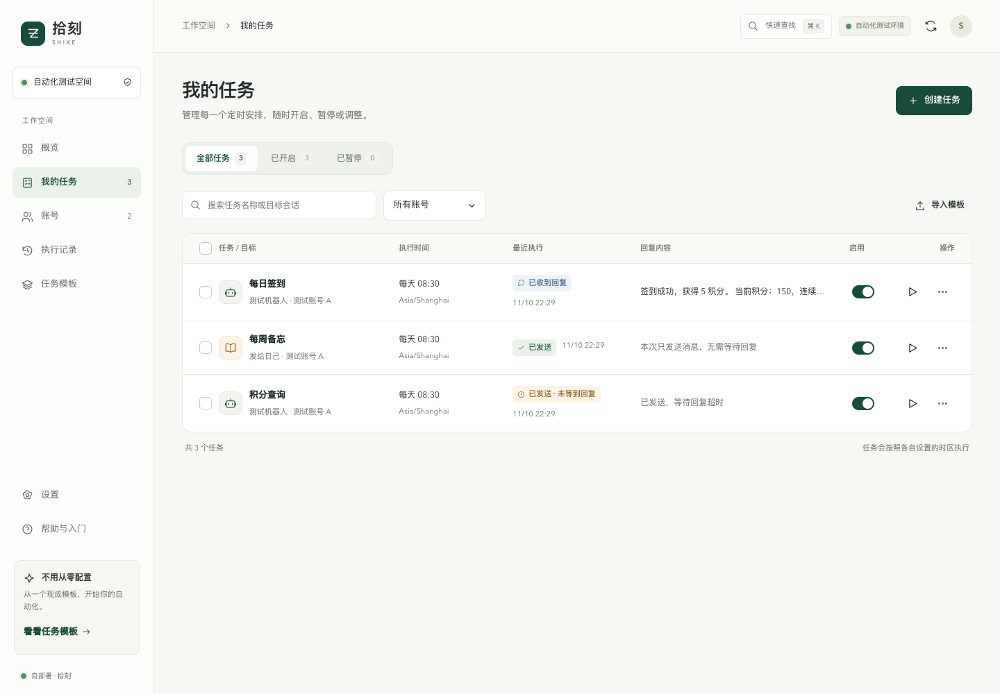
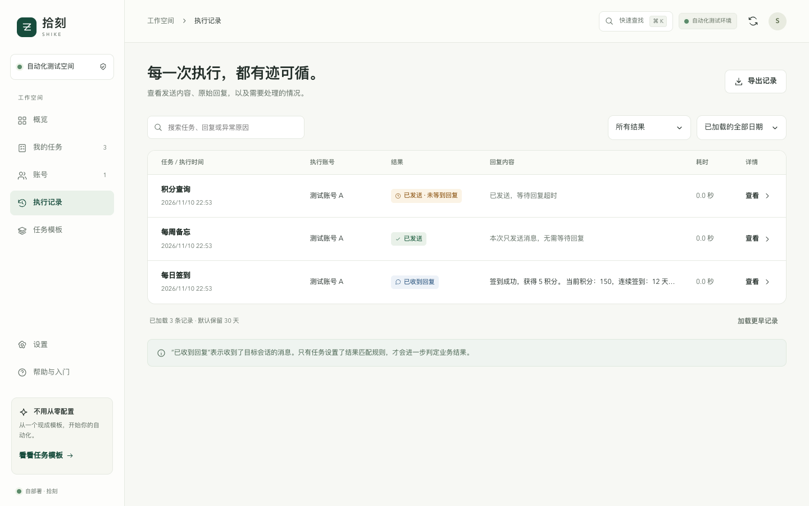

<div align="center">
  <h1>拾刻 Shike</h1>
  <p><b>在浏览器里安排你的 Telegram 自动任务</b></p>
  <p>扫码接入账号 · 定时发送消息 · 配置按钮步骤 · 直接查看回复</p>
  <p><a href="docs/docker-deployment.md">部署指南</a> · <a href="docs/telegram-api.md">申请 Telegram API</a> · <a href="README.actions.md">GitHub Actions 入门版</a></p>
</div>

拾刻是一个自部署的 Telegram 自动任务面板。你可以给机器人定时发送签到指令、查询积分，也可以给自己的收藏夹或有发送权限的群组安排提醒。账号、目标、消息和时间都在网页里配置，执行后直接在列表查看原始回复。

它从 HDHive 签到脚本发展而来，现在支持通用 Telegram 任务，仓库名称沿用 `hdhive-auto-checkin`。每个人部署自己的实例，使用自己的 Telegram 用户账号执行任务。



*截图使用演示账号和消息。*

## 先选使用方式

| 方式 | 适合什么情况 | 开始使用 |
| --- | --- | --- |
| **拾刻 Web 面板** · 当前 `codex/shike-backend` 分支 | 希望扫码登录、浏览器管理、多账号任务和执行记录 | [下方快速部署](#快速部署当前可用的源码构建方式) · [完整部署指南](docs/docker-deployment.md) |
| **GitHub Actions 入门版** · `telethon` 分支 | 只有简单的定时消息任务，不想维护常驻服务 | [脚本说明](README.actions.md) · [切换到 telethon](https://github.com/suversal/hdhive-auto-checkin/tree/telethon) |

两种方式独立使用，配置不会自动同步。迁移同一条签到任务时，先暂停旧计划，避免重复发送。`main` 与 `feature_yescaptcha` 保留旧网页签到实现，新用户从上面两条路线选择即可。

## 可以做什么

- **多账号管理**：扫码登录，也支持手机号验证码或导入自己的 Telethon StringSession；接入后随时编辑账号备注。
- **消息与按钮流程**：发送文字、等待回复、间隔等待、按文字点击当前消息里唯一匹配的按钮。
- **定时执行**：每日、每周、固定间隔、单次、五字段 Cron；每个任务独立设置时区和随机延迟。
- **回复与记录**：列表直接显示回复，长内容省略并可悬停查看；详情保留实际发送内容、步骤日志、耗时和异常原因。
- **结果规则与通知**：按自己的成功、失败关键词匹配；仅异常、每次执行、每日摘要或不通知，可发到收藏夹或通过独立通知机器人发送。
- **日常管理**：任务模板导入导出、批量启停、搜索、执行记录导出，以及备份、升级和回退命令。

普通消息可以只发送，不必等待接收方回复；机器人签到需要收集结果时，再开启“等待对方回复”。图片验证码及需要人工验证的流程仍需自己处理。

## 快速部署：当前可用的源码构建方式

**目前尚未发布正式 Release 安装包。先按本节构建，不要直接拉取示例配置里的 `latest` 镜像。** 正式安装包发布后，也可以使用[安装包部署方式](docs/docker-deployment.md#方式二已有正式-release-安装包时)。

### 1. 准备环境并下载

准备一台**常开、能连接 Telegram** 的电脑、NAS 或服务器，安装 Git、Docker 和 `docker compose` 插件。macOS / Windows 可使用 [Docker Desktop](https://docs.docker.com/get-started/get-docker/)，Linux 按 [Docker Engine 指南](https://docs.docker.com/engine/install/)安装。Windows 使用 Linux 容器，以下脚本在 WSL 终端执行。部署目标为 Linux AMD64 / ARM64，32 位 ARM 不在支持范围内。

在准备部署的机器上运行：

```bash
git clone --depth 1 --branch codex/shike-backend https://github.com/suversal/hdhive-auto-checkin.git shike
cd shike
docker compose version
docker info
```

如果已经有 `shike` 安装目录，不要覆盖，按[升级说明](docs/docker-deployment.md#源码构建版升级)操作。

### 2. 构建镜像并设置管理密码

在刚下载的目录中创建配置，将镜像设为本机构建的 `shike:local`：

```bash
sed 's|^SHIKE_IMAGE=.*|SHIKE_IMAGE=shike:local|' .env.shike.example > .env
docker compose -f compose.yaml -f compose.build.yaml build
SHIKE_PULL_POLICY=never sh shike.sh install
```

第一条命令用于**新安装**，不要拿它覆盖已有 `.env`。构建过程会在 Docker 内安装依赖、编译前端，宿主机不需要安装 Python 或 Node。

按终端提示输入两遍管理密码，至少 10 位，输入不回显。它用于以后登录网页面板；初始化在部署端完成，网页不开放公开注册。无需额外的首次设置口令。

Linux 如需 `sudo` 操作 Docker，构建命令也加 `sudo`，安装用 `sudo env SHIKE_PULL_POLICY=never sh shike.sh install`。后续管理命令同样需要相应权限。

### 3. 打开网页

本机部署：打开 **`http://127.0.0.1:8787`**，用刚才的管理密码登录。

云服务器默认也只监听本机。在**自己的电脑**另开终端，建立 SSH 转发并保持开启：

```bash
ssh -N -L 8787:127.0.0.1:8787 用户名@服务器地址
```

然后在自己电脑打开 `http://127.0.0.1:8787`。若本机端口被占用，将第一个 `8787` 改成 `8789`，浏览器也改用 `8789`。需要手机直接访问或长期使用域名时，见 [HTTPS 配置](docs/docker-deployment.md#有域名可选自动-https)。

## 申请 API 并接入账号

1. 打开 [my.telegram.org/apps](https://my.telegram.org/apps)，用带国家区号的 Telegram 手机号登录。**官网验证码通过 Telegram 发到已登录设备，不是短信**，见[官网登录说明](https://my.telegram.org/auth)。
2. 进入 **API development tools**，创建应用。App title 可填 `Shike Tasks`，Short name 填 `shiketasks`，Platform 选 `Desktop`。已有应用时使用现有信息。
3. 保存应用页面的 **App api_id** 和 **App api_hash**，在拾刻首次引导或“设置 → Telegram 连接”填入。
4. 点击“添加账号”，起一个方便识别的备注名。手机 Telegram → **设置 → 设备 → 连接桌面设备**，扫描自己面板上的二维码并确认。开启两步验证的账号，再输入 Telegram 两步验证密码。

完整表单、凭证区别和申请排错见 [API ID / API Hash 申请说明](docs/telegram-api.md)。Web 面板不需要预先生成 StringSession，也不需要先创建通知机器人。支持多个 Telegram 账号，但一个实例只有一套管理权限，并非面向公众注册的多用户平台。

## 创建第一条任务

先在 Telegram 手动确认机器人绑定和指令可用，再进入“我的任务 → 创建任务”：

1. **选择方式**：普通签到选“发送一条消息”，需要按钮交互选“消息＋按钮操作”。
2. **账号与目标**：选择由哪个账号发送，搜索最近会话或填写目标的 `@用户名` / 数字 ID。选“发给自己”会发到该账号的 Saved Messages（收藏夹）。
3. **操作内容**：填实际消息。只发送提醒时关闭等待；收集机器人结果时开启“等待对方回复”，需要时再设成功、失败关键词。
4. **时间与确认**：例如每天 `07:30`、`Asia/Shanghai`，选择通知方式，确认后创建。

“创建并开启”只保存后续计划，**不会立即发消息**。要马上验证，点列表的执行按钮，核对弹窗里的账号、目标和内容后确认。按钮文字必须在当前消息中唯一匹配；不会自动打开链接、分享联系人或位置。

消息支持 `{{date}}`、`{{time}}`、`{{weekday}}`，执行时按任务时区替换。关闭浏览器不影响服务端执行，部署机器和 Docker 需要保持运行。

## 如何看执行结果



| 状态 | 含义 |
| --- | --- |
| 已发送 | 只发送流程完成，不需要对方回复 |
| 已收到回复 | 收到了目标会话的消息，具体业务结果看原文 |
| 规则匹配成功 / 失败 | 命中你设置的关键词；失败关键词优先 |
| 已发送 · 未等到回复 | Telegram 已确认发送，但等待期间没收到符合条件的回复 |
| 发送结果未确认 | 请求结果不确定，先去 Telegram 核对再决定是否重跑 |

**收到回复不等于签到成功，等待超时也不等于消息没发出去。** 系统不会因没等到回复或连接恢复而自动重发业务消息。服务重启会标记未完成执行为中断，跳过过期计划，恢复后续计划；同一账号的任务顺序执行，Telegram 限流等待按账号处理。

## 维护、备份与升级

在原安装目录运行：

| 操作 | 命令 |
| --- | --- |
| 查看状态 / 日志 | `sh shike.sh status` / `sh shike.sh logs` |
| 启动 / 停止，保留数据 | `sh shike.sh start` / `sh shike.sh stop` |
| 补设尚未初始化的管理密码 | `sh shike.sh init` |
| 忘记管理密码后重设 | `sh shike.sh reset-password` |
| 备份 | `sh shike.sh backup` |
| 切回上次镜像 | `sh shike.sh rollback` |

源码构建版按以下步骤更新：

```bash
git pull --ff-only
docker compose -f compose.yaml -f compose.build.yaml build
SHIKE_PULL_POLICY=never sh shike.sh upgrade
```

升级脚本会先备份，再替换镜像；发现正在执行的任务时会提示稍后再试。正式 Release 的版本升级、镜像回退与数据恢复见[完整部署指南](docs/docker-deployment.md)。

保留原安装目录、`.env` 和 Docker 数据卷，**不要执行 `docker compose down -v`**。账号和任务在数据卷里，数据库与加密密钥必须一起保留。备份包含账号授权能力，别上传到公开仓库。

## 常见问题

- **Telegram 连接超时**：部署机器也需要能连接 Telegram；在“设置 → Telegram 连接”中配置服务器可达的 SOCKS5 / HTTP 代理。容器的 `127.0.0.1` 指容器自己，不是宿主机代理。
- **给个人或群组发送后总是超时**：编辑任务，关闭“等待对方回复”。仅发送任务不需要对方回话。
- **镜像拉取失败 / denied / manifest unknown**：当前先按上面的源码构建方式安装；正式镜像发布后还需维护者将 GHCR 包设为 Public。
- **网页提示尚未设置管理密码**：回部署目录执行 `sh shike.sh init`。换设备访问同一个实例只需登录，不用重新初始化。
- **可以部署到 GitHub Actions / Cloudflare Pages 吗**：Actions 使用独立脚本入门版；Web 完整版需要常驻 Python 后端和数据卷，不能仅托管到静态 Pages。Cloudflare 可作为域名代理或 Tunnel 入口，后端仍需运行。

## 文档与反馈

- [Docker 部署、HTTPS、升级、备份恢复](docs/docker-deployment.md)
- [Telegram API 申请](docs/telegram-api.md)
- [本地源码开发与验证](docs/development.md)
- [维护者：自动发布镜像与安装包](docs/releasing.md)
- [GitHub Actions 入门版](README.actions.md) · [HDHive 历史说明](README.hdhive.md)

验证码和两步验证密码不写入数据库；账号会话、API Hash 和通知 Bot Token 在服务端加密保存，页面不回显。加密密钥和数据库同在自己的部署环境中，备份和服务器权限同样需要保管好。

反馈问题请通过 [Issues](https://github.com/suversal/hdhive-auto-checkin/issues)，附上使用分支、部署方式、报错与脱敏日志，勿上传 Session、API Hash、二维码、密码或数据备份。也可联系 [Telegram @suversal](https://t.me/suversal)。
